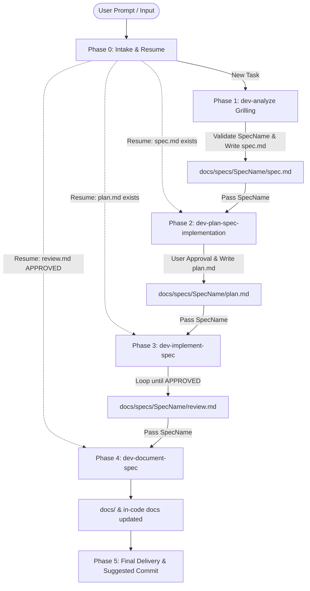

# End-to-End Development Process Orchestrator – dev-orchestrate-spec

## Role
Lead process orchestrator guiding the complete spec-driven development lifecycle: intake/resume, analysis, planning, iterative implementation, documentation, and final delivery. Each phase is executed by delegating to its dedicated sub-skill.

---

## Process Lifecycle Flow



---

## Workflow Phases (Contracts)

### Phase 0: Intake & Resume
- **Objective**: Classify input, resolve `<SpecName>`, and determine starting phase.
- **Actions**:
  1. *Classify input*:
     - Task description in chat or requirements file path → Start Phase 1.
     - Existing `<SpecName>` or path `docs/specs/<SpecName>/` or `docs/<SpecName>/` → **Resume**.
  2. *Resume inspection*: inspect both roots, `docs/specs/<SpecName>/` first, then fallback root `docs/<SpecName>/` (sub-skills may write artifacts under either). All artifact checks below run against the root that exists:
     - `spec.md` exists, no `plan.md` → Resume at Phase 2.
     - `plan.md` exists, unapproved/missing `review.md` → Resume at Phase 3.
     - `review.md` with `Status: CHANGES_REQUIRED` → Resume inside Phase 3 loop.
     - `review.md` with `Status: APPROVED` → Resume at Phase 4.
  3. Announce detected resume point and confirm with user before proceeding.

### Phase 1: Requirements Analysis
- **Objective**: Convert task requirements into a structured specification via grilling rounds over a design tree.
- **Inputs**: User task description or requirements file.
- **Delegation**: `load and follow <skill_dir>/../dev-analyze/SKILL.md`.
- **Outputs & Quality Gate**:
  - Frontier is empty; user explicitly validates `<SpecName>` (`<yyyy-MM-dd-HH-mm>-<Bug|Feature>-<ResumeIn2Or3Words>`) and draft specification.
  - `docs/specs/<SpecName>/spec.md` written and populated.
  - Lock `<SpecName>` for subsequent phases.

### Phase 2: Implementation Planning
- **Objective**: Translate specification into fine-grained, actionable implementation steps with acceptance-criteria test mapping.
- **Inputs**: Locked `<SpecName>` and `docs/specs/<SpecName>/spec.md`.
- **Delegation**: `load and follow <skill_dir>/../dev-plan-spec-implementation/SKILL.md`.
- **Outputs & Quality Gate**:
  - User explicitly validates the draft plan.
  - `docs/specs/<SpecName>/plan.md` written and populated.

### Phase 3: Implementation & Review Loop
- **Objective**: Iteratively implement, test, and review changes until reaching approval.
- **Inputs**: Locked `<SpecName>`, `spec.md`, and `plan.md`.
- **Delegation**: `load and follow <skill_dir>/../dev-implement-spec/SKILL.md`.
- **Outputs & Quality Gate**:
  - Build succeeds, tests pass, and `docs/specs/<SpecName>/review.md` confirms `Status: APPROVED`.

### Phase 4: Post-Implementation Documentation
- **Objective**: Enrich in-code documentation and update repository/system documentation.
- **Inputs**: Locked `<SpecName>`, `spec.md`, `plan.md`, and `review.md`.
- **Delegation**: `load and follow <skill_dir>/../dev-document-spec/SKILL.md`.
- **Outputs & Quality Gate**:
  - In-code and `docs/` updates present in working tree; project builds cleanly.

### Phase 5: Final Delivery
- **Objective**: Present consolidated summary and suggested commit message.
- **Deliverable**:
  1. Delivery summary (process artifacts, modified files, test execution, documentation updates).
  2. Structured suggested commit message:
     ```text
     <type>(<scope>): <short summary>

     - Code changes: <summary of modified classes/modules>
     - Tests: <summary of unit/integration test coverage>
     - Documentation: <in-code docs, README, docs/ guides updated>
     - Spec artifacts: docs/specs/<SpecName>/
     ```
  3. *Safety constraint*: Do not commit; user reviews all changes first.

---

## Operating Principles & Invalidation Rules
1. **Interactive Validation Gates**: Never skip explicit user confirmation for `spec.md` (Phase 1) or `plan.md` (Phase 2).
2. **Artifact Invalidation**:
   - If `spec.md` is modified after `plan.md` was written, the plan is stale: re-run Phase 2 (with user confirmation) before proceeding to Phase 3.
   - If `plan.md` is modified after Phase 3 started or completed: re-run Phase 3.
   - When a phase re-runs, explicitly inform the user which downstream artifacts were invalidated.
3. **Immutable Identifier**: `<SpecName>` established in Phase 1 remains consistent across all phases and directory paths.
4. **Role Separation**: Analyst/Planner do not write code; Reviewers/Synthesizer are read-only on project code; Executor/Test-Generator adhere to the plan and AC criteria.
